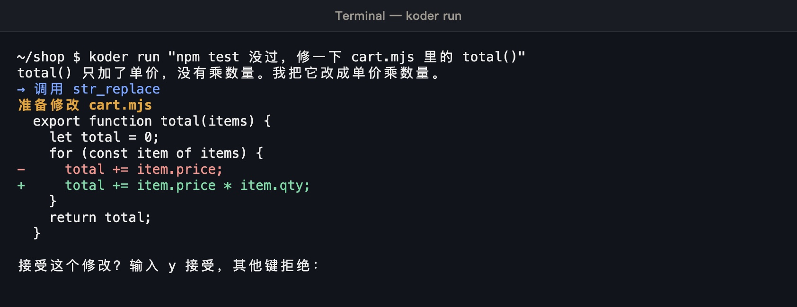
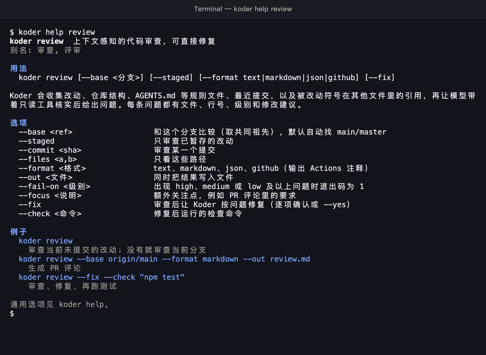
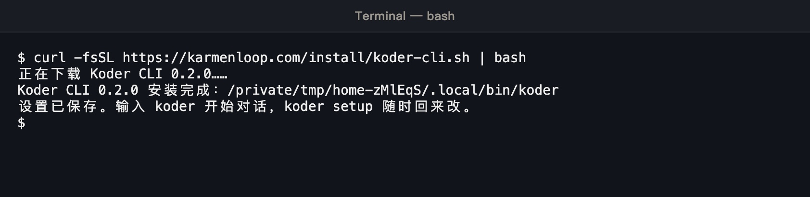

# Koder SDK

Koder works on your own computer. You give it a task. It reads the project, proposes file changes, and runs commands. Every file change and every command stops for your decision before it takes effect. You bring your own model account and pay that provider directly. This release does not include a model.

This repository is the SDK: the way another program calls Koder. It is written for TypeScript, JavaScript, and Python. The license is MIT.

Site: <https://karmenloop.com>  
CLI: <https://github.com/KarmenLoop/koder-cli>  
Download: <https://karmenloop.com/download.html>  
Email: <info@karmenloop.com>

## Products

| Product | Where it runs | How you open it |
| --- | --- | --- |
| Koder for desktop | A window for the task, the diff, and the decision | Download page on the site |
| Koder TUI | A full-screen terminal | `koder-tui` |
| Koder CLI | One command in a terminal for review, edits, tests, and flows | `koder` |
| Koder SDK | Your own TypeScript, JavaScript, or Python program | This repository |

The desktop app, the TUI, and the CLI share one model configuration and one language setting. The SDK uses that same run.

## The kernel is not published

The kernel is KARMEN LOOP. It is not in this repository. It is not in the CLI repository. It is not part of the MIT license. Copyright © KARMEN / Koder. All rights reserved. Installing a build from the site runs the kernel. Downloading that build does not give you the kernel source, and this repository does not offer the kernel for further development.

## What a run looks like

The first `koder` opens setup. When no model is configured, that row says so. Arrow keys or the mouse select a row.


`koder run` prints the diff before it writes. Red lines are removed. Green lines are added. `y` writes the file. Any other key leaves the file unchanged.



`koder help review` prints the usage, options, and examples for that command. The same form works for every command: `koder help <command>`.



`koder-tui` fills the terminal. The top bar shows the version, workspace, model, and mode. The middle is the conversation. The bottom is the input.


An edit in the TUI opens a diff window. `y` accepts it. `n` or Esc rejects it.


The two edit screens were captured against a scripted local test endpoint, not a connected model service. The interface is the real Koder CLI 0.2.0 and Koder TUI 0.1.0.

After install, the terminal looks like this:



## Install the CLI first

The SDK drives the Koder CLI on this machine. Node.js 22 or newer is required. Python 3.9 or newer is required only for the Python package.

macOS, Linux, or WSL:

```bash
curl -fsSL https://karmenloop.com/install/koder-cli.sh | bash
```

Windows PowerShell:

```powershell
irm https://karmenloop.com/install/koder-cli.ps1 | iex
```

Then connect a model. The key stays in an environment variable. The config file stores the variable name.

```bash
export DEEPSEEK_API_KEY="your-key"
koder model set --preset deepseek --key-env DEEPSEEK_API_KEY
koder doctor
```

A local Ollama model:

```bash
koder model set --preset local --model qwen3:8b
```

Clone this repository and build the JavaScript package:

```bash
git clone https://github.com/KarmenLoop/koder-sdk.git
cd koder-sdk
npm run build
```

Python, from the same checkout:

```bash
pip install ./python
```

`KODER_NODE` selects the Node binary. `KODER_SDK_SERVER` selects `bin/koder-sdk-server.mjs` when it is not next to the Python package. `KODER_CLI_ROOT` selects the CLI checkout when it is not installed beside this repository.

## Tutorial: one call from JavaScript

```js
import { query } from "koder-sdk";

const result = await query({
  workspace: "/path/to/project",
  prompt: "Fix the empty dereference in src/app.js",
  permission: "acceptEdits",
});

console.log(result.status, result.text, result.files);
```

The same value is a stream:

```js
for await (const event of query({ workspace, prompt })) {
  if (event.type === "delta") process.stdout.write(event.text);
}
```

`result.status` is `completed`, `cancelled`, `error`, or `unreachable`. `result.exitCode` matches the CLI: `0` finished, `1` cancelled or failed, `2` could not run. `result.files` lists paths written during that turn.

## Tutorial: several turns

```js
import { createKoder } from "koder-sdk";

const koder = await createKoder({
  workspace: "/path/to/project",
  permission(request) {
    if (request.kind === "edit") return request.path.startsWith("src/");
    if (request.kind === "command") return request.command.startsWith("npm test");
    return "cancel";
  },
});

const session = await koder.session({ mode: "code" });
await session.send("Read the project layout");
const second = await session.send("Add tests for utils");
await koder.close();
```

One session runs one turn at a time. A second `send` before the first finishes throws `BUSY`. `session.cancel()` or an `AbortSignal` stops the turn. `session.reset()` starts a new conversation. `session.messages` reads the history. `koder.session({ readOnly: true })` offers only tools that do not change files.

## Tutorial: Python

```python
import asyncio
from koder_sdk import Koder, query

async def main():
    result = await query(
        "Fix the empty dereference in src/app.py",
        "/path/to/project",
        permission="acceptEdits",
    )
    print(result.status, result.text, result.files)

    async with await Koder.create("/path/to/project", permission=lambda request: request["kind"] == "edit") as koder:
        session = await koder.session(mode="code")
        await session.send("Read the project layout")
        await session.send("Add tests for utils")

asyncio.run(main())
```

Scripts without an event loop use `query_sync(prompt, workspace, ...)`. Permission functions and custom providers may be plain functions or `async` functions. Model fields accept either `base_url` or `baseUrl`.

## Models

The SDK uses the first source that exists:

1. `provider`, an in-process object with `complete()`
2. `model`, an object or a path to a provider JSON file
3. `KODER_MODEL`, `KODER_BASE_URL`, and `KODER_API_KEY`
4. The model saved by `koder model add`

If none of these exist, the call fails with `MODEL_MISSING`.

## Permission

Koder asks your function before it edits a file, runs a command, or puts a question to the user.

| `kind` | Fields | Accepted answers |
| --- | --- | --- |
| `edit` | `path`, `before`, `after`, `diff` | `true`, `false`, or `{ allow }` |
| `command` | `command` | `true`, `false`, or `{ allow }` |
| `question` | `question`, `options` | an option index, the option text, or `{ choice }` |

`"cancel"` or `{ cancel: true }` stops the turn. Presets are `"deny"` (the default), `"acceptEdits"`, and `"auto"` (edits and commands). A preset never answers a question. A thrown error, an unreadable answer, or an option that is not in the list is treated as a refusal or a cancel. Login and password requests are always refused and are never passed to your function.

## Errors

Stable codes: `MODEL_MISSING`, `BAD_WORKSPACE`, `BAD_MODE`, `BAD_PERMISSION`, `BAD_PROVIDER`, `BAD_PROMPT`, `BUSY`, `CLOSED`, `CLI_NOT_FOUND`. Python also uses `NODE_NOT_FOUND`, `SERVER_NOT_FOUND`, `SERVER_NOT_BUILT`, and `BRIDGE_CLOSED`.

## Other languages

`node bin/koder-sdk-server.mjs` speaks one JSON object per line. stdout carries protocol frames only. Closing stdin shuts the process down.

Client requests use `{ "id", "method", "params" }` for `initialize`, `koder.create`, `koder.close`, `session.create`, `session.send`, `session.cancel`, `session.reset`, and `session.messages`. Replies are `{ "id", "result" }` or `{ "id", "error": { "code", "message" } }`. Events arrive as `{ "method": "run.event", "params": { "runId", "event" } }`. When `permission` or `provider` is `"client"`, the server asks `permission.request` and `provider.complete`. An error or a dropped connection is a refusal.

## License

The SDK in this repository is under the MIT License. See `LICENSE`.

The KARMEN LOOP kernel is not in this repository, is not published, and is not under the MIT License. Copyright © KARMEN / Koder. All rights reserved.
